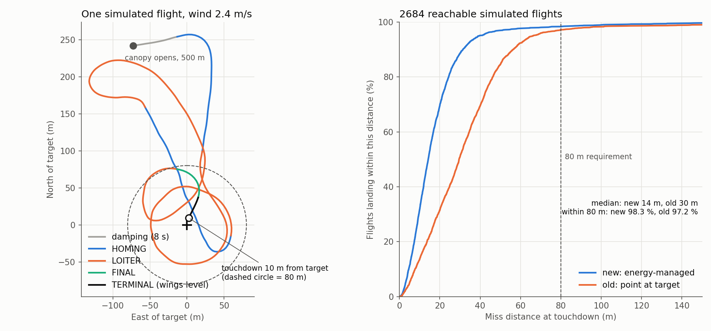

# Target-Landing

Autonomous targeted landing for a 1 kg CanSat under a steerable single-skin
parafoil. **Requirement: touch down within 80 m of a target coordinate.**
Built for the ISRO / IN-SPACe CanSat India Student Competition 2026 by
CU Jammu Astro (CanSat Team 039).

> **Status (6 Oct 2026):** bench and ground tests 1 to 7 passed on the real
> hardware. SD logging and the watchdog are being installed. **No drop test
> has been flown yet.** Every canopy number in the simulation is a modelling
> range, not a measurement.

---

## How it works, in one paragraph

A parafoil cannot stop or slow down; it only glides. Pointing it at the
target makes it arrive with height to spare and land wherever the leftover
glide takes it. This controller manages **energy** instead. It aims at a
*virtual target*: the point in the moving air that the wind will carry onto
the real target exactly at touchdown (`VT = target − wind × t_go`). It
compares the glide still available (`L = airspeed × t_go`) with the distance
to that point. The difference is excess energy, which is burned off in a
50 m orbit (LOITER). When only about 30 m of excess is left, it flies at the
target and uses S-turns to burn the rest (FINAL). Below 8 m it holds the
wings level (TERMINAL). Wind and airspeed are measured in flight from GPS
ground velocity during the orbit turns; sink rate comes from the barometer.

Full mathematics, design history and verification:
[`docs/Parafoil_Guidance_Report.pdf`](docs/Parafoil_Guidance_Report.pdf).

## Results (PC Monte-Carlo of the exact flight code)

3000 randomised flights. Each one varies the canopy (airspeed, sink rate,
turn response, brake slack, left/right asymmetry), the wind (0 to 6 m/s,
shear, veer, gusts), the sensor errors and the deployment point; 20 % of
flights include a 10 s GPS dropout.

| Flight class | Flights | Within 80 m | Median miss |
|---|---|---|---|
| All physically reachable targets | 2684 | **98.3 %** | 14 m |
| Reach margin above 150 m | 2451 | **99.8 %** | 13.9 m (95th pct. 34 m) |
| Old point-at-target logic, same flights | 2684 | 97.2 % | 30 m |

Almost every miss over 80 m is a flight whose target was outside the
canopy's physical glide reach; no software can recover those.



## Repository layout

```
firmware/
  Parafoil_Guided_Landing/          Arduino sketch folder (Teensy 4.1)
    Parafoil_Guided_Landing.ino     drivers, flight-state machine, commands, logging
    ParafoilGuidance.h              guidance core (pure C++, also compiled on PC)
    ResumeRecord.h                  EEPROM record for in-flight reset recovery
    host_sim/monte_carlo.cpp        Monte-Carlo harness (PC)
    host_sim/plot_results.py        regenerates docs/guidance_results.png
  sensor_bringup/                   early sensor bring-up sketch (superseded, never run on hardware)
tools/host_build/                   builds the .ino on a PC against mock libraries and flies SIM mode
docs/
  Parafoil_Guidance_Report.tex/.pdf full technical report (LaTeX)
  ALGORITHM_SUMMARY.md              short design summary
  BENCH_TESTS.md                    step-by-step hardware test procedure and results
  history/                          earlier project context archive
```

## Hardware

| Function | Device | Connection |
|---|---|---|
| Flight computer | Teensy 4.1 | |
| GNSS | Foxeer M10Q-180 | Serial3, 38400 baud; GPS TX → pin 15, GPS RX → pin 14; 5 V |
| Barometer | BMP581 | I²C 0x46/0x47 (SDA 18, SCL 19) |
| IMU | LSM6DSO32 | I²C 0x6A |
| Compass | QMC5883 | I²C 0x0D (fallback only) |
| Steering | 2 × Feetech ST-3009 | Serial1 half-duplex 1 Mbps, ID 1 = left, ID 2 = right |
| Deployment | SG90 | pin 8 (140° locked, 180° released) |
| Logging | built-in microSD | `FLTnnn.CSV` at 10 Hz |

## Building the firmware

Arduino IDE with Teensyduino. Board **Teensy 4.1**, USB Type **Serial**,
CPU **600 MHz**. Libraries:

- TinyGPSPlus (Mikal Hart)
- Adafruit LSM6DS (pulls in Adafruit BusIO and Unified Sensor)
- SCServo 1.0.2 (class `SMS_STS`)
- WDT_T4 / Watchdog_t4 (tonton81); without it the sketch builds with no watchdog

Keep all three files of `firmware/Parafoil_Guided_Landing/` in one folder of
that name. Serial Monitor: **115200 baud, line ending "Newline"**.

## Bench test order

`PING` → `LEFT`/`RIGHT` → `GYROTEST` → `BARO` → `SIM` → outdoor GPS
`STATUS` → `WALK` → SD log and watchdog. Details and recorded results:
[`docs/BENCH_TESTS.md`](docs/BENCH_TESTS.md).

## Running the simulations on a PC

```bash
# Monte-Carlo (needs g++)
cd firmware/Parafoil_Guided_Landing/host_sim
g++ -O2 -std=c++14 -o mc monte_carlo.cpp
./mc 3000 5 99                 # final configuration
MC_OLD=1 ./mc 3000 5 99        # old point-at-target logic on the same flights
MC_FAIL=1 ./mc 1000 5 1        # list every flight that misses by more than 80 m

# Whole firmware, built against mock libraries, flying its SIM mode
cd tools/host_build
./build.sh                                   # SIM 400 300 500 2 1
./build.sh "TLM OFF;SIM -300 200 500 -3 2"
```

More options (gains, orbit radius, baro bias, GPS rate) are listed at the end
of the report.

## Known limitations

- Not yet flown. Real airspeed, sink rate, turn rate per servo count and
  brake slack must be measured in drop tests, then `SLACK` and `GAINS` set.
- `TURN_SIGN` and the brake pull signs are set from bench rotation only; the
  first drop must confirm the canopy turns the commanded way.
- The target ground height relative to the ARM point (`ELEV`) must be known
  within a few metres; a 20 m error pushes the 95th-percentile miss to about
  64 m.
- With a strong headwind the target can be physically out of reach; see the
  reach table in the report.
- Flare is implemented but disabled until tested.
